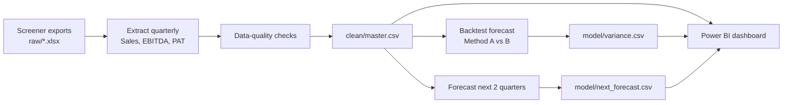

# IT Services Sector: Forecast Variance Dashboard

A small finance-analytics project that collects quarterly results of five Indian IT services companies, cleans them into a single dataset, forecasts revenue, EBITDA and net profit, **backtests** the forecast against reported actuals, and presents actual-vs-forecast variance in an interactive dashboard.

> **Status:** pipeline and forecast complete. Dashboard and AI commentary sections below are marked where they are still to be completed. Replace every `[X]` with your own results before publishing.

---

## 1. Why this project

Finance teams repeatedly do the same cycle: pull data from several sources, clean it, compare **actuals against forecast**, explain the **variances**, and report them through dashboards. This project reproduces that cycle on public data, with the repetitive steps automated in one script so the whole dataset can be rebuilt when a new quarter is reported.

**What it demonstrates**

| Skill | Where it appears |
|---|---|
| Data pipeline (multiple sources, one clean table) | `build_dataset.py` |
| Data-quality validation | Five automated checks on every run |
| Forecasting and variance analysis | Backtest of two methods, ±5% variance flag |
| Dashboard / self-service reporting | Power BI report with company and quarter slicers |
| Reporting automation | One command rebuilds all outputs |
| AI-assisted reporting | Variance commentary drafted with an LLM and manually verified (see section 9) |

---

## 2. Companies and period

- **Companies:** TCS, Infosys, Wipro, HCLTech, Tech Mahindra (consolidated figures)
- **Period:** quarterly results from Q1 FY25 (Jun 2024) to Q2 FY27 (Sep 2026), 10 quarters per company
- **Units:** ₹ crore
- **Fiscal year:** April to March (for example, Q2 FY27 = Jul-Sep 2026)
- **Metrics:** Sales (revenue), Operating Profit (EBITDA as defined by Screener), Net Profit (PAT)

---

## 3. Data sources

| Source | Used for |
|---|---|
| [Screener.in](https://www.screener.in) "Export to Excel" (consolidated view) | Quarterly Sales, Operating Profit, Net Profit |
| Company investor-relations pages and BSE / NSE financial-results filings | Manual spot-checks of the exported data |

> **Note on data rights:** raw Screener exports are licensed for personal use, so they are **not included in this repository** (`raw/` is git-ignored). To reproduce the results, export the files yourself as described in section 6.

---

## 4. Method



### 4.1 Pipeline
1. Each company's **Quarters** sheet is read from `raw/`.
2. Quarter-end dates are rebuilt by counting back from the latest reported quarter (the date headers in the exported files are unreliable after copy/paste).
3. Each quarter is labelled with the Indian fiscal quarter (for example, `Q2 FY27`).
4. All companies are stacked into one tidy table (`clean/master.csv`).

### 4.2 Data-quality checks (run automatically)
1. No missing values in revenue, EBITDA or PAT
2. No duplicate company-quarter rows
3. Revenue is positive
4. EBITDA margin is between 15% and 30% for every row
5. Every company has the same number of quarters

In addition, quarterly figures were reconciled against the annual totals in the same exports (for example, four quarters of FY26 Sales summed to the annual FY26 figure). Result: `[X of X reconciled within rounding]`.

### 4.3 Forecasting
For a quarter *t*, using only data available before *t*:

- **Method A (seasonal growth):** `Revenue forecast = revenue in the same quarter last year x (1 + YoY growth of the previous quarter)`
- **Method B (baseline):** `Revenue forecast = previous quarter's revenue`
- **EBITDA and PAT forecast:** `Revenue forecast (Method A) x average margin of the previous 4 quarters`

The first quarters are used as history, and the remaining quarters of each company (the **test set**) are forecast and compared with the actuals.

### 4.4 Variance and accuracy
- `Variance = Actual - Forecast`
- `Variance % = Variance / Forecast x 100`
- **MAPE** (mean absolute percentage error) is the average of the absolute variance % across all test quarters.
- A quarter is flagged when its variance is beyond **±5%**.

### 4.5 Forward forecast
The next two quarters (Q3 FY27 and Q4 FY27) are forecast with Method A. Commit these before the results are published so the commit date shows the forecast was made in advance, then add the actuals in a later update.

---

## 5. Results

> Fill this table from the output of `python3 build_dataset.py` after all five companies are loaded. Do not edit the numbers to look better; if the simple baseline wins, say so.

**Data**

| Item | Result |
|---|---|
| Companies | `[X]` |
| Quarters per company | `[X]` |
| Data points | `[X]` |
| Data-quality checks passed | `[X of 5]` |

**Backtest** (`[X]` company-quarters)

| Metric | Method A | Method B |
|---|---|---|
| Revenue MAPE | `[X%]` | `[X%]` |
| EBITDA MAPE | `[X%]` | n/a |
| PAT MAPE | `[X%]` | n/a |
| Quarters beyond ±5% revenue variance | `[X of X]` | `[X of X]` |

**Key observations** (write 3 to 4 honest findings, for example):
- Which method was more accurate and by how much
- Which company was hardest to forecast and why that might be
- Whether profit was harder to forecast than revenue
- Any quarter with an unusually large variance and what the data shows

**Forward forecast** (to be compared with actuals when reported)

| Company | Quarter | Revenue (₹ cr) | EBITDA (₹ cr) | PAT (₹ cr) |
|---|---|---|---|---|
| `[X]` | Q3 FY27 | `[X]` | `[X]` | `[X]` |

---

## 6. How to run

**Requirements:** Python 3.9+, `pandas`, `openpyxl`

```bash
pip install pandas openpyxl
```

**Steps**
1. Create a `raw/` folder next to `build_dataset.py`.
2. Export each company from Screener.in (**Export to Excel**, consolidated view) and save it as `raw/<CompanyName>.xlsx`, for example `raw/TCS.xlsx`. The file name becomes the company name.
3. If you are updating for a new quarter, change `LAST_QUARTER` at the top of `build_dataset.py` (for example `"2026Q4"`).
4. Run:

```bash
python3 build_dataset.py
```

**Outputs**

| File | Contents |
|---|---|
| `clean/master.csv` | One row per company-quarter: revenue, EBITDA, PAT, fiscal quarter |
| `model/variance.csv` | Backtest: actual, forecast (A and B) and variance % |
| `model/next_forecast.csv` | Forecast for the next 2 quarters |

The console also prints the data-quality results and the MAPE figures.

---

## 7. Dashboard (Power BI)

> Add screenshots to `dashboard/screenshots/` and link them here.

**Data model:** `master`, `variance` and `next_forecast` loaded from CSV, joined through a `Companies` table so one slicer filters everything.

**Core measures (DAX)**
```
Actual Revenue = SUM(variance[actual_rev])
Forecast Revenue = SUM(variance[fc_rev_A])
Variance = [Actual Revenue] - [Forecast Revenue]
Variance % = DIVIDE([Variance], [Forecast Revenue])
Baseline Variance % = DIVIDE(SUM(variance[actual_rev]) - SUM(variance[fc_rev_B]), SUM(variance[fc_rev_B]))
```

**Pages**
1. **Overview:** KPI cards, company and quarter slicers, actual vs forecast chart
2. **Variance detail:** table with red/green flags beyond ±5%
3. **Forecast accuracy:** Method A vs Method B error by company
4. **Outlook:** revenue history with the next 2 forecast quarters
5. **Data quality:** checks and reconciliation results

The report file is `dashboard/variance_dashboard.pbix`.

---

## 8. Repository structure

```
.
├── build_dataset.py
├── README.md
├── .gitignore
├── raw/                  # not committed (licensed source data)
├── clean/
│   └── master.csv
├── model/
│   ├── variance.csv
│   └── next_forecast.csv
├── dashboard/
│   ├── variance_dashboard.pbix
│   └── screenshots/
└── outputs/              # AI commentary, reports
```

Suggested `.gitignore`:
```
raw/
.DS_Store
__pycache__/
```

---

## 9. AI-assisted commentary (to be completed)

Plan: send each company's variance table to the Claude API and request a short commentary that uses **only the numbers provided** and does not guess causes. Every figure in the generated text is then checked against `variance.csv`.

| Item | Result |
|---|---|
| Figures in generated commentary | `[X]` |
| Figures verified correct | `[X]` |
| Manual write-up time per company | `[X min]` |
| Script plus review time per company | `[X min]` |

Delete this section if you do not complete it.

---

## 10. Limitations

- **Small sample:** about 10 quarters per company and 5 test quarters each, so error figures are indicative, not statistically strong.
- **Simple models:** the forecasts use growth and margin rules, not full financial models, and ignore guidance, deal wins, currency moves and one-off items.
- **Metric definitions:** "EBITDA" is Screener's operating profit and may differ slightly from company-reported figures.
- **One-off items:** unusual entries (for example, negative other income in a quarter) are left as reported.
- **Public historical data:** this is an analytical exercise, not investment advice.

---

## 11. Possible extensions

- Add more companies or a wider period
- Add a company-comparison page (growth, margins, forecast error side by side)
- Compare forecasts with management guidance
- Schedule the script to refresh when new results are filed

---

## 12. Author

**Divya Jassal** | B.Tech Mathematics and Computing, Delhi Technological University
[LinkedIn](#) | [GitHub](#) | divyajassal1703@gmail.com

*Data: Screener.in and company filings. This project is independent and not affiliated with any of the companies analysed.*